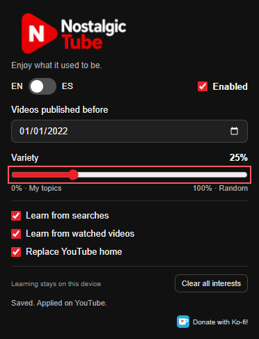
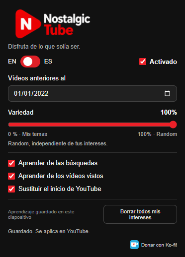

<p align="center"></p>

<p align="center"><strong>Enjoy what it used to be.</strong></p>
<p align="center">A nostalgic YouTube feed for Brave and desktop Chromium browsers.</p>

<p align="center">
  <a href="https://github.com/yomidee/NostalgicTube/actions/workflows/check.yml"></a>
  <a href="https://github.com/yomidee/NostalgicTube/releases"></a>
  <a href="https://github.com/yomidee/NostalgicTube/releases"></a>
  <a href="https://github.com/yomidee/NostalgicTube/blob/main/LICENSE"></a>
  <br>
  <a href="https://github.com/yomidee/NostalgicTube#install-in-brave-chrome-or-edge"></a>
  <a href="https://github.com/yomidee/NostalgicTube#install-in-brave-chrome-or-edge"></a>
  <a href="https://github.com/yomidee/NostalgicTube/blob/main/extension/manifest.json"></a>
</p>
<p align="center"><a href="docs/README.es.md">Español</a> · <a href="CHANGELOG.md">Changelog</a> · <a href="docs/HISTORY.md">Project history</a> · <a href="PRIVACY.md">Privacy</a> · <a href="https://ko-fi.com/yomidee">Donate with Ko-fi!</a></p>

**Current version: 0.8.50 · Beta · Manifest V3**

NostalgicTube generates a feed of videos uploaded before your chosen date, using native YouTube cards on home and compact horizontal cards on watch pages. It learns interests locally and mixes related videos with unrelated discoveries. By default the cutoff is January 1, 2022.

## A note from the creator

Hey! I'm the creator of NostalgicTube.

I got tired of all the viral trends, AI-generated music, and endless streams of new content, so I decided to give AI a taste of its own medicine. I used it to build an extension that brings back the good old days of YouTube!

With NostalgicTube, you can choose a cutoff date and explore videos uploaded before it. There's also a slider that mixes your interests with random discoveries. At 100%, Random ignores your learned interests. The extension doesn't impose a minimum view count or rank videos by popularity, so both overlooked uploads and big classics can turn up. YouTube's search results can still favor particular videos or languages, so this isn't a completely unbiased sample of its entire catalogue.

Hope you enjoy it! Pro tip: try January 2022 or earlier as a starting point if you're looking for an older YouTube experience. That's the default cutoff I chose for NostalgicTube, not a verified dividing line for AI-generated content. A date alone can't guarantee that a video is free of AI.

Happy watching!

## Features

- Optional Nostalgic autoplay, off by default: an upper-right player card with the next old recommendation, a 10-second countdown, Play now and Cancel.
- Clean YouTube search field: the cutoff stays applied in the URL while the visible field shows only your search terms.

- Continuous **0–100% Variety**: your topics at 0%, independent Random at 100%.
- No minimum view count or popularity sorting in any mode: zero-view videos are eligible too.
- Automatic learning from YouTube searches and, after 12 seconds of visible playback, video-title keywords.
- Up to 10,000 locally stored interests, managed automatically; **Clear all interests** resets learning.
- Native home cards, horizontal watch cards, duplicate prevention across the feed and progressive loading while scrolling.
- Automatic recovery from empty batches, with backoff rather than repeated manual retries.
- Automatic `before:YYYY-MM-DD` enforcement on YouTube search URLs, including searches opened from browser shortcuts or bookmarks.
- English by default, Spanish available, compact dark popup, automatic settings saving.

## Install in Brave, Chrome or Edge

1. Download [NostalgicTube 0.8.50 ZIP](https://github.com/yomidee/NostalgicTube/releases/download/v0.8.50/NostalgicTube-0.8.50-Brave.zip) and extract it into a permanent folder.
2. Open the extensions page for your desktop browser and enable **Developer mode**:

   | Browser | Address to enter in the address bar |
   | --- | --- |
   | Brave | `brave://extensions` |
   | Google Chrome | `chrome://extensions` |
   | Microsoft Edge | `edge://extensions` |

3. Choose **Load unpacked** and select the extracted **NostalgicTube** folder containing `manifest.json`.
4. Reload YouTube tabs. Disable older copies of this extension to avoid interference.

The same ZIP is intended for all three desktop browsers, even though its filename includes “Brave”. No conversion or separate package is needed. Keep Developer mode enabled and keep the extracted folder in place. In Edge, **Allow extensions from other stores** is not needed for this local-folder installation. Chrome and Edge installation steps follow their official documentation; end-to-end behavior has not been independently tested in both browsers.

Official installation guides: [Chrome](https://developer.chrome.com/docs/extensions/get-started/tutorial/hello-world#load-unpacked), [Edge](https://learn.microsoft.com/en-us/microsoft-edge/extensions-chromium/getting-started/extension-sideloading).

If cloning this repository, load its **extension/** folder instead. No build step, account setup or API key is required.

To update and preserve learning, replace the files in your existing installation folder, reload the extension and reload YouTube. Uninstalling first removes its local data.

## Preview

| English | Español |
| --- | --- |
|  |  |

Screenshots show the current popup in a separate test profile, not a personal YouTube account.

## How it works

The extension reads YouTube search-result pages, extracts video metadata, checks approximate upload dates and mixes eligible results. Related searches use locally learned topics. Random searches use independent terms and randomized date windows. The native YouTube renderer draws the cards. See [architecture](docs/ARCHITECTURE.md).

## Practical limits

- Random is a random selection among returned search candidates, **not uniform sampling of YouTube's entire catalogue**. YouTube may still favor popular, regional or language-specific results.
- Relative ages are approximate. Unrecognized dates and ranges crossing the cutoff are excluded.
- **YouTube autoplay / Up next is not controlled.** It may select a newer video. A direct video URL is not blocked.
- Date enforcement applies to YouTube searches, not Google or Brave Search pages.
- YouTube's internal markup and components may change. Consent screens, throttling and unavailable results may prevent loading. Automatic retries cannot guarantee recovery.
- Older upload dates do not guarantee that a video contains no AI-generated material.

## Development

```sh
node --test tests/*.test.cjs
python scripts/package.py
```

Tests use Node's built-in runner; packaging uses only Python's standard library. The output ZIP is written to `dist/`. See [testing](docs/TESTING.md) and [contributing](CONTRIBUTING.md).

## History and releases

The original project evolved from **YouTube Antes** (a local filter) through related-video panels and native YouTube rendering into NostalgicTube. This repository imports the **actual preserved source snapshots**, with tags for recovered versions. All documented milestones appear in the changelog; missing historical ZIPs are explicitly identified, never fabricated. See the [archive inventory](docs/HISTORY.md) and [machine-readable release catalogue](releases/catalog.json).

## License and support

Code is distributed under the [MIT license](LICENSE); existing notices are preserved. See [asset provenance](docs/ASSETS.md) for the user-supplied branding and its processing history. Independent project, not affiliated with YouTube, Google or Brave.

[Donate with Ko-fi!](https://ko-fi.com/yomidee)

## Update checks

Press **Check for updates** beside the version. After optional GitHub access is granted, the popup compares the installed version with published releases, including betas. It shows **Up to date!** when current or **Check GitHub to update!** when older. The latter opens the GitHub release page. Checks run only on click; downloads and installation are manual. A failed check can be retried and does not report that you are current.

## Loading behavior

Searches run two at a time, with an 8-second source deadline and an 18-second batch deadline. A batch can finish early once it has enough eligible videos for the selected variety mix. Empty searches retry after 1.5–20 seconds; request failures back off up to 60 seconds. Timing behavior is tested with simulated responses, not a guarantee of real-world loading speed.

## Watch-page layout

Recommendations use horizontal cards with 16:9 thumbnails. Once replacement cards are available, the original YouTube recommendations and topic filters are hidden. Disabling the extension restores them. The home mix label appears below its toolbar; the loaded-video counter is omitted. Hiding recommendations does not filter autoplay.

## Loading messages

A single Loading more videos heading is accompanied by one of 28 playful phrases, rotated every five seconds during loading and retry waits. The phrases are translated into English and Spanish and disappear when loading finishes. Jokes about AI are decorative, not a claim that the extension detects AI-generated videos.

Discovery search languages: expand the selector below Variety to enable or disable any of eight languages. All are enabled by default and changes save automatically. This controls search terms, not the spoken language of videos.

Version numbers were renumbered to 0.x. Users of the previous numbering need a one-time manual file replacement and reload; keep the installation folder to retain settings. See [version mapping](docs/VERSIONING.md).
